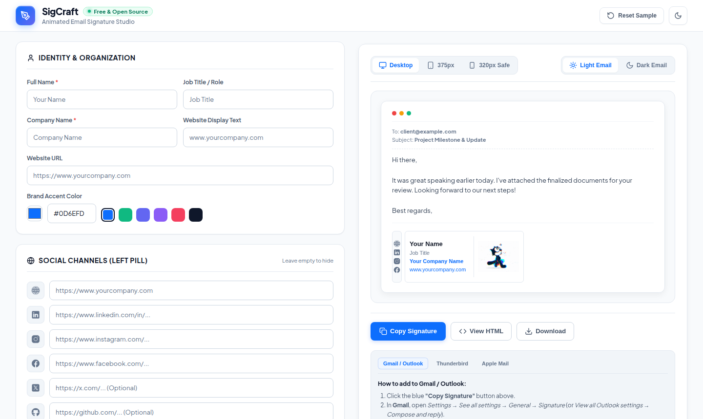

# SigCraft
### Free, Open-Source Animated Email Signature Studio
**Modern • Responsive • 320px Mobile-Safe • Dark-Mode Tested • Zero Watermarks**

[Live Demo](https://sigcraft.satvainfotech.com/) • [Key Features](#key-features) • [Try Online](#try-it-online) • [Supported Clients](#supported-email-clients) • [Contributing](#contributing)

 

---

## Why SigCraft?

Most email signature builders suffer from the same frustrating problems:
* **The Subscription Trap:** Big signature generators (HubSpot, WiseStamp, Canva) charge \$5–\$15/month or forcibly inject ugly *"Created with XYZ"* watermark links into your emails.
* **Broken on Mobile:** Over 60% of emails are opened on smartphones. Traditional signature tables overflow horizontally on screens under 375px wide. **SigCraft guarantees strict 320px mobile viewport safety.**
* **Broken Animated Logos:** Email engines often stretch, distort, or break animated GIFs. SigCraft enforces strict 1:1 aspect-ratio square geometry.
* **Dark Mode Blindness:** Pure black icons disappear into black backgrounds when recipients open emails in dark mode. SigCraft uses universal slate-contrast geometry and includes a real-time **Light & Dark Email preview simulator**.
* **Zero Tracking / 100% Privacy:** No login required. No databases. No telemetry. Your private information never leaves your browser.

---

## Key Features

- **Guaranteed 320px Mobile Protection:** Built from the ground up with a resilient table architecture that never scrolls horizontally on iPhone SE, mini, or Android devices.
- **Animated GIF & Logo Support:** Works with any static PNG/JPG or animated GIF with strict 1:1 square ratio preservation.
- **Simulated Dark Mode Email Client:** Toggle between `Light Email` and `Dark Email` directly in the preview toolbar to verify contrast before sending.
- **Brand Customization:** Custom brand colors, real-time hex input, and curated accent swatches.
- **Universal Contrast Social Icons:** Slate grey icons (`#64748b`) crafted for high WCAG readability across both white and dark mode reading panes.
- **Triple Export Pipeline:**
  1. **Copy Signature:** Formatted rich-text HTML copied straight to your visual clipboard.
  2. **View HTML:** Clean inline raw HTML viewer with a one-click code copy button.
  3. **Download:** Export an independent `email-signature.html` file.
- **Interactive Setup Guides:** Step-by-step tabs for **Gmail**, **Outlook**, **Mozilla Thunderbird**, and **Apple Mail**.
- **Built-in Image URL Converter:** Convert GitHub blob URLs to raw public URLs directly in the app.
- **Zero Dependencies:** Pure vanilla HTML, CSS, and modern JavaScript. Loads in milliseconds.

---

## Try It Online

Access the live studio directly in your browser without any installation:

**[Launch SigCraft Studio](https://sigcraft.satvainfotech.com/)**  
*(Free • Open Source • No Account Required)*

Alternatively, clone or download this repository and open `index.html` locally.

---

## Supported Email Clients

SigCraft signatures have been rigorously tested and confirmed compatible across:

| Email Client | Support Level | Recommended Method |
| :--- | :---: | :--- |
| **Gmail (Web & Mobile Apps)** | Full | `Copy Signature` &rarr; Paste in Settings |
| **Microsoft Outlook (Web & New Outlook)** | Full | `Copy Signature` &rarr; Paste in Compose & Reply |
| **Mozilla Thunderbird** | Full | `Download` file &rarr; "Attach signature from file" OR `View HTML` &rarr; "Use HTML" |
| **Apple Mail (macOS & iOS)** | Full | `Copy Signature` &rarr; Paste (uncheck "Match font") |
| **ProtonMail** | Full | `Copy Signature` &rarr; Paste in Settings |
| **Yahoo / AOL Mail** | Full | `Copy Signature` &rarr; Paste in Settings |

---

## Tech Stack

- **HTML5:** Semantic table-based architecture optimized for Outlook and Gmail layout engines.
- **CSS3:** Custom properties (CSS variables), responsive grid layout, and dark mode theming.
- **JavaScript (ES6+):** Pure client-side DOM manipulation, Clipboard API, and Blob generator.
- **Icons:** Inline SVGs for application UI + public high-contrast CDN icons for email compatibility.

---

## Contributing

Contributions are warmly welcomed:

1. Fork the Project (`https://github.com/SatvaInfoTech/sigcraft/fork`).
2. Create your Feature Branch (`git checkout -b feature/AmazingFeature`).
3. Commit your Changes (`git commit -m 'feat: add some amazing feature'`).
4. Push to the Branch (`git push origin feature/AmazingFeature`).
5. Open a Pull Request.

---

## License

Distributed under the **MIT License**. See [`LICENSE`](LICENSE) for more details. 

Free forever for personal, freelance, and commercial use.

---

## Author & Maintainer

**[Rajveer Vaghamshi](https://github.com/rajveervaghamshi)**  
Founder & CEO, **[Satva Info Tech](https://satvainfotech.com)** • [GitHub (@SatvaInfoTech)](https://github.com/SatvaInfoTech)

